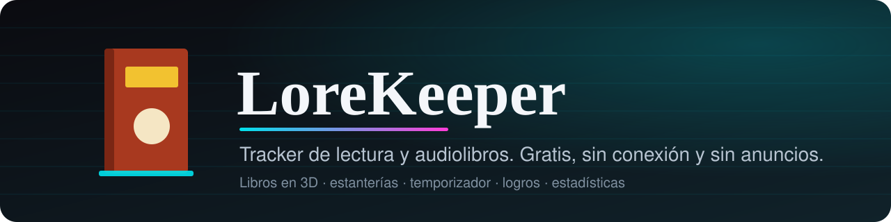
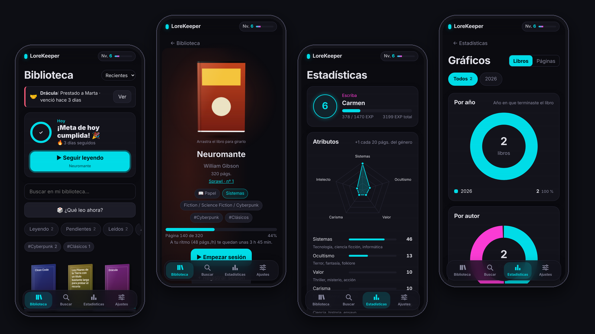
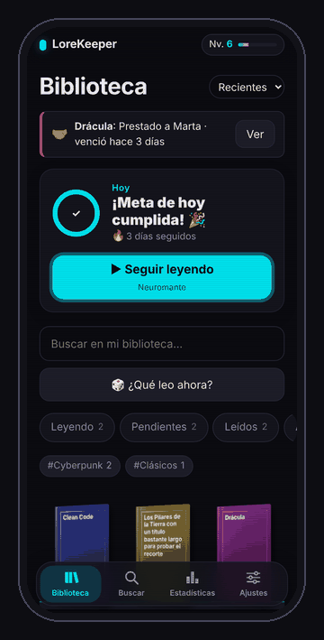
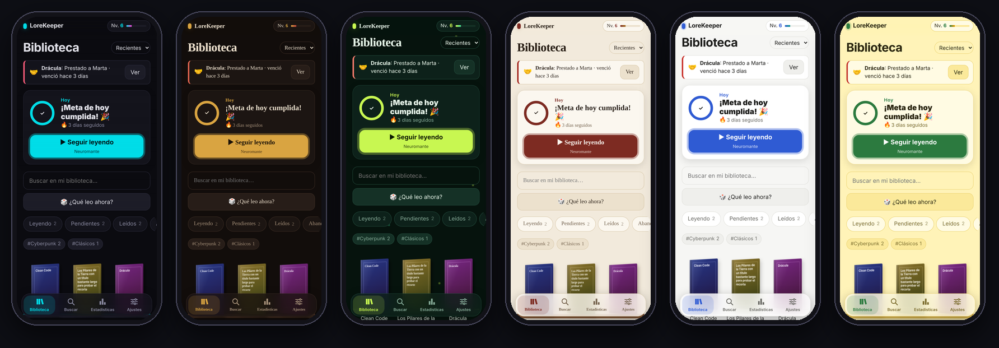
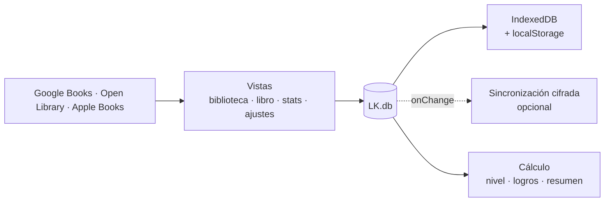

<div align="center">



<br>

[](https://ivanchux.github.io/lorekeeper/)
&nbsp;


**Una reinterpretación libre de Bookmory**: libros en 3D, estanterías, temporizador que sigue en segundo plano, logros y un sistema de niveles opcional. Hecha para quien lee y, sobre todo, para quien escucha audiolibros.



</div>

---

## Índice

[Probarla](#-probarla-en-30-segundos) · [Funciones](#-funciones) · [Estéticas](#-seis-estéticas) · [Tus datos](#-tus-datos) · [Instalar](#-instalarla-en-el-móvil) · [Arquitectura](#-arquitectura) · [Límites de una PWA](#-límites-de-una-pwa) · [RPG](#-sistema-rpg-opcional) · [English](#-english-summary)

## 📱 Probarla en 30 segundos

<table>
<tr>
<td width="160" align="center"><br><sub>Escanéalo con el móvil</sub></td>
<td>

**https://ivanchux.github.io/lorekeeper/**

- **iPhone:** ábrela en Safari → Compartir → *Añadir a pantalla de inicio*.
- **Android:** Chrome → menú → *Instalar aplicación*.
- **Ordenador:** doble clic en `index.html`. Funciona casi todo salvo instalarla, los avisos, la sincronización y la lectura de texto de fotos, que necesitan `http`.

</td>
</tr>
</table>

## ✨ Funciones

| | |
|---|---|
| ⏱️ **Temporizador en segundo plano** | Sales de la app o apagas la pantalla y el reloj sigue, porque usa la hora real. Aviso opcional con *Pausar* y *Terminar*. |
| 🎧 **Audiolibros de verdad** | Tiempo escuchado, velocidad de 0,75× a 3×, inicio y final del audio como posición, «me quedan» (como Audible o Storytel) o porcentaje. |
| 📚 **Libro 3D** | Con el color de la portada en lomo, cantos y brillo. Se arrastra para girarlo. |
| 🗂️ **Biblioteca** | Estanterías, sagas, formatos, etiquetas, préstamos con aviso y «¿Qué leo ahora?». |
| 🔎 **Añadir libros** | Búsqueda en Google Books, Open Library y Apple Books, escáner de ISBN con la cámara y alta manual. |
| 📥 **Importar** | Bookmory, Goodreads o cualquier CSV/Excel, con detección de columnas y vista previa. Busca las portadas que falten. |
| 🖼️ **Portada a mano** | Si ningún catálogo la tiene, la eliges desde tu galería en la ficha del libro. |
| 💬 **Citas** | Escritas a mano o desde una foto (el texto se reconoce en tu dispositivo) y compartibles como imagen. |
| 🏅 **Logros y niveles** | 24 logros, atributos por género y rangos. Todo opcional: el *modo fácil* lo quita. |
| 📊 **Estadísticas** | Calendario, ritmo, objetivo anual, libros por año, autores, valoraciones y etiquetas. |
| 🍩 **Gráficos en rosco** | Por año, autor, género, editorial y formato, en libros o en páginas. |
| 🎆 **Tu año en libros** | Resumen anual compartible. Se abre solo el 1 de enero. |

<details>
<summary><b>Más detalle de cada parte</b></summary>

**Leer**
- *Hoy*: meta diaria (minutos o páginas) con anillo de progreso, racha y un botón grande de «Seguir leyendo».
- El temporizador avisa en la barra de notificaciones, pone el tiempo en el título y te protege si te dejas el reloj en marcha horas.
- Sesiones por páginas o por porcentaje, con atajos de 15, 30, 45, 60 y 90 minutos.
- Audio: capítulo opcional, «vas por…» en vivo con el reloj, progreso por posición, ritmo medio y logros propios.
- Animaciones por toda la app (entradas escalonadas, barras y números que se llenan, confeti al terminar un libro). Se apagan con «Reducir movimiento» del sistema o con el interruptor de Ajustes.

**Diseño de app en el móvil** (`css/mobile.css`)
- Títulos grandes, barra inferior flotante, tarjetas redondeadas, botones de 48–56 px, ventanas que suben desde abajo y pestañas en píldora.
- En el tema Terminal usa la letra del sistema para que no se vea comprimido.
- Instalada en iPhone abre a pantalla completa. En escritorio no cambia nada.

**Estadísticas con libros importados**
- Los libros importados cuentan en totales y gráficas, repartidos entre sus fechas de inicio y fin. Si faltan páginas o tiempo, se estiman: 40 páginas/h en papel y ebook, y 2 minutos ≈ 1 página en audio.
- Esos datos estimados no dan EXP, ni logros, ni racha.

**Modo fácil**: letra grande, botones grandes y nada de juego. Tamaño de letra en 3 niveles.

</details>

## 🎨 Seis estéticas

Tres oscuras (Terminal, Grimorio, Luciérnaga) y tres claras (Biblioteca, Minimal, Girasol). Se cambian en Ajustes.

<p align="center"></p>


## 🔒 Tus datos

- Todo se queda en tu dispositivo (IndexedDB, con respaldo en localStorage).
- Copias: enviar por el menú del móvil (Drive, WhatsApp, correo), descargar JSON y restaurar.
- Sincronización opcional y cifrada entre dispositivos con un servidor propio (`backend/`).
- Recordatorio diario como evento de calendario (`.ics`) y aviso dentro de la app.
- Sin cuentas, sin anuncios, sin seguimiento.

## 📲 Instalarla en el móvil

- **iPhone:** abre el enlace en Safari → Compartir → *Añadir a pantalla de inicio* y usa el icono. La app instalada tiene su propio almacenamiento, así que los libros se añaden ya desde ahí. Los avisos de la sesión de lectura requieren iOS 16.4 o superior.
- **Android:** Chrome → menú → *Instalar aplicación*.
- **Servirla tú mismo:** `python -m http.server 8080` o `npx serve .`. Para el móvil hace falta `https` (GitHub Pages, Cloudflare Pages o tu servidor; `backend/` también sirve la app).

## 🧱 Arquitectura

Scripts clásicos que comparten el objeto global `LK` (sin módulos ES), por eso funciona también desde `file://`.



```
├── index.html, manifest.webmanifest, sw.js
├── css/        themes · base · book3d · features · motion · mobile
├── js/
│   ├── util, prefs, books, storage, rpg, audio, achievements, summary
│   ├── theme, api, book3d, fx, charts, ui, cards
│   ├── csv (CSV y XLSX), scanner, ocr, sync, reminder, timer, onboarding
│   ├── views/  library · search · book · stats · rosco · settings · importer · extras
│   ├── app.js  (arranque y rutas)
│   └── vendor/ ZXing y Tesseract.js (licencias en js/vendor/THIRD_PARTY.md)
├── backend/    servidor de sincronización (Worker o Node) + pruebas
├── docs/img/   imágenes de este README
└── icons/
```

- **Local primero.** Las vistas solo usan `LK.db`; la sincronización se engancha a `db.onChange`.
- **Progreso calculado, no guardado.** Nivel, EXP, atributos y logros salen de las sesiones: si borras una, todo se recalcula.
- **Temas por variables CSS.** Añadir uno = un bloque en `themes.css` + una entrada en `theme.js`.
- **Sincronización cifrada de extremo a extremo** con fusión por registros y lápidas de borrado (ver `backend/README.md`).

## ⚠️ Límites de una PWA

No es una app de tienda, y hay cosas que el navegador no permite:

| Cosa | Situación |
|---|---|
| Cronómetro vivo en la pantalla de bloqueo o la Dynamic Island | No se puede. Se compensa con el aviso persistente (Android; en iPhone, solo con la app instalada) y un reloj basado en la hora real |
| Notificación programada con la app cerrada | No sin un servidor push. Se usa un evento de calendario con alarma |
| Escáner de códigos en Safari | No existe `BarcodeDetector`: se usa la librería ZXing incluida |
| iPhone: borrado de datos | Safari puede borrar los datos de webs que no se usan en semanas. Instalada en la pantalla de inicio es más seguro; haz copias o activa la sincronización |
| Widgets, Siri, Apple Watch | No |
| Sincronizar con Google Drive | No implementado (exige registrar un cliente OAuth). Alternativa: copia por el menú compartir o servidor propio |

## 🎮 Sistema RPG (opcional)

| Concepto | Regla |
|---|---|
| EXP por sesión | páginas × 2 + minutos × 1,5 |
| Bonus por terminar un libro | +50 EXP (no en libros importados) |
| EXP para subir de nivel | nivel ^ 1,5 × 100 |
| Atributos | Empiezan en 10; +1 por cada 20 páginas del género (audio: 2 min ≈ 1 página) |

Rangos: Aprendiz (1) · Lector (3) · Escriba (5) · Erudito (8) · Archivista (12) · Cronista (16) · Custodio del Saber (20) · Guardián del Lore (30).

## 🧪 Pruebas

`cd backend && npm test` prueba el servidor. La interfaz se ha probado con Playwright (Chromium): flujos, desbordes en móvil (320, 360 y 390 px, letra grande, los seis temas) y `file://`. Además se ha probado en iPhones reales.

## 🌍 English summary

**LoreKeeper** is a free, offline-first reading and audiobook tracker, built as a PWA with plain HTML, CSS and JavaScript (no frameworks, no dependencies). It features 3D books, shelves, a background-safe reading timer, achievements, an optional RPG levelling system, yearly stats with donut charts, a Bookmory/Goodreads CSV importer with automatic cover lookup, and optional end-to-end encrypted sync. Six themes (three dark, three light). Everything stays on your device.

**Try it:** https://ivanchux.github.io/lorekeeper/ · Install it from Safari (*Share → Add to Home Screen*) or Chrome (*Install app*).

## 📜 Licencia

El código y los diseños están bajo [PolyForm Noncommercial 1.0.0](https://github.com/Ivanchux/lorekeeper/blob/main/LICENSE).

**Puedes, sin pedir permiso:**

* Usar la app y compartir el enlace.
* Estudiar el código y modificarlo para uso personal, educativo o sin ánimo de lucro.
* Subirla a tu propio hosting, siempre gratis y sin anuncios, conservando el aviso de copyright y la licencia.
* Hacer vídeos, capturas y reseñas de la app, aunque tu canal esté monetizado.
* Inspirarte en las ideas y el funcionamiento para crear tu propia app desde cero.

**Necesitas mi permiso por escrito para:**

* Vender la app, una copia o una versión modificada.
* Publicarla en tiendas de aplicaciones.
* Incluirla en una web con anuncios, suscripciones o compras.
* Usar el código o los diseños (libro 3D, temas, iconos) en un producto comercial.

LoreKeeper es una reinterpretación independiente de una idea que ya existe; no está afiliada a Bookmory ni a ninguna otra app de lectura. Las librerías de `js/vendor/` conservan su licencia original (ver `js/vendor/THIRD_PARTY.md`).
